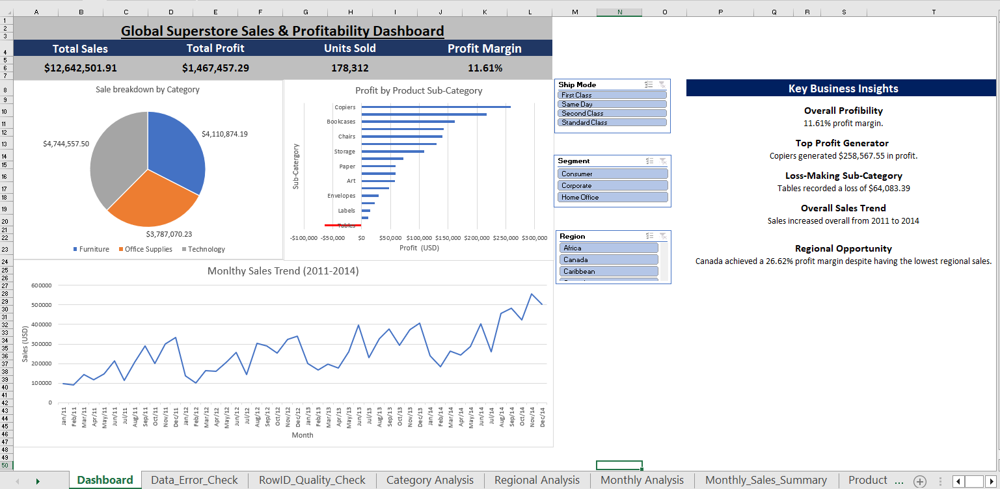

# Global Superstore | Sales & Profitability Analytics

An interactive Excel analytics project exploring sales performance, profitability, product trends and regional results using **Microsoft Excel, Power Query, PivotTables, PivotCharts and interactive slicers**.

The objective was to transform raw sales data into a clear, interactive dashboard that helps stakeholders understand business performance and identify opportunities for improvement.

## 📊 Dashboard Preview

## 🎯 Project Objectives

- Analyse overall sales and profitability.
- Identify high-performing and loss-making product categories.
- Explore monthly sales trends and regional performance.
- Build an interactive dashboard for business reporting.
- Perform data quality checks to improve confidence in the analysis.
- Translate findings into actionable business insights.

## 🛠️ Tools & Technical Skills

| Tool / Technique | Application |
|---|---|
| Microsoft Excel | Data analysis, calculations and reporting |
| Power Query | Data preparation, cleaning and transformation |
| PivotTables | Aggregating sales, profit and product performance |
| PivotCharts | Visualising trends and comparing performance |
| Interactive slicers | Filtering results by shipping mode, customer segment and region |
| KPI cards | Communicating key business performance indicators |
| Data quality checks | Checking for duplicate records and errors |

## 📈 Key Performance Indicators

| Metric | Result |
|---|---:|
| Total Sales | $12,642,501.91 |
| Total Profit | $1,467,457.29 |
| Units Sold | 178,312 |
| Profit Margin | 11.61% |

These indicators provide an overview of sales volume, revenue generation and overall profitability.

## 🔍 Key Business Insights

### 1. Sales Growth
Sales increased from approximately **$2.26 million in 2011 to $4.30 million in 2014**, representing an increase of approximately 90%.

This highlights substantial revenue growth over the period analysed.

### 2. Product Profitability
- **Copiers:** Generated approximately $258,567.55 in profit, making them a strong contributor to profitability.
- **Tables:** Recorded an approximate loss of $64,083.39, highlighting an area requiring further investigation.

These findings demonstrate why analysing profit alongside sales is important when evaluating product performance.

### 3. Regional Performance
Regional analysis allows performance to be compared across markets and identifies areas that may warrant further investigation.

### 4. Monthly Sales Trends
Monthly sales analysis helps reveal changes in revenue over time and provides a starting point for investigating seasonal patterns and planning future sales activity.

## 📊 Dashboard Features

The dashboard brings the analysis together in one interactive reporting view.

- KPI cards summarising sales, profit, units sold and profit margin.
- Category sales breakdown.
- Profitability comparison across product sub-categories.
- Monthly sales trend visualisation.
- Interactive slicers for shipping mode, customer segment and region.
- Business insights highlighting important findings.

The slicers allow users to explore the data dynamically and compare performance across different business segments.

## 🧹 Data Preparation & Quality

Data preparation and validation formed part of the analytical workflow.

- Used Power Query to inspect and prepare the dataset.
- Checked for duplicate records.
- Checked for errors.
- Reviewed the cleaned dataset before creating the analysis.
- Organised the analysis into dedicated worksheets for category, monthly, product and regional performance.

The duplicate and error checks returned no records requiring correction in the checks performed.

## 💼 Business Value

This project demonstrates how spreadsheet-based analytics can support business decision-making by helping stakeholders:

- Monitor revenue and profitability.
- Identify profitable and loss-making products.
- Compare regional and customer-segment performance.
- Explore changes in sales over time.
- Investigate potential areas for commercial improvement.

The analysis also reinforces the importance of combining data preparation, validation, visualisation and business interpretation rather than focusing on charts alone.

## 📁 Repository Contents

| File | Description |
|---|---|
| `Global_Superstore_Analytics.xlsb` | Excel workbook containing the analysis and interactive dashboard |
| `dashboard.png` | Dashboard preview |
| `README.md` | Project overview, methodology and key findings |

## 🚀 How to Explore the Project

1. Preview the dashboard image above.
2. Download `Global_Superstore_Analytics.xlsb` from this repository.
3. Open the workbook in Microsoft Excel.
4. Navigate through the analysis worksheets.
5. Use the dashboard slicers to explore different segments and regions.

**Note:** The workbook is saved in Excel Binary Workbook (`.xlsb`) format to reduce file size. Open it in desktop Microsoft Excel for the intended interactive experience.

## 👨‍💻 Project Outcome

This project demonstrates practical application of Excel-based data analytics, including data preparation, quality checks, performance analysis, interactive reporting and business insight generation.

It forms part of my developing data analytics portfolio as I continue building my skills in **Excel, SQL, Power BI and Python**.
